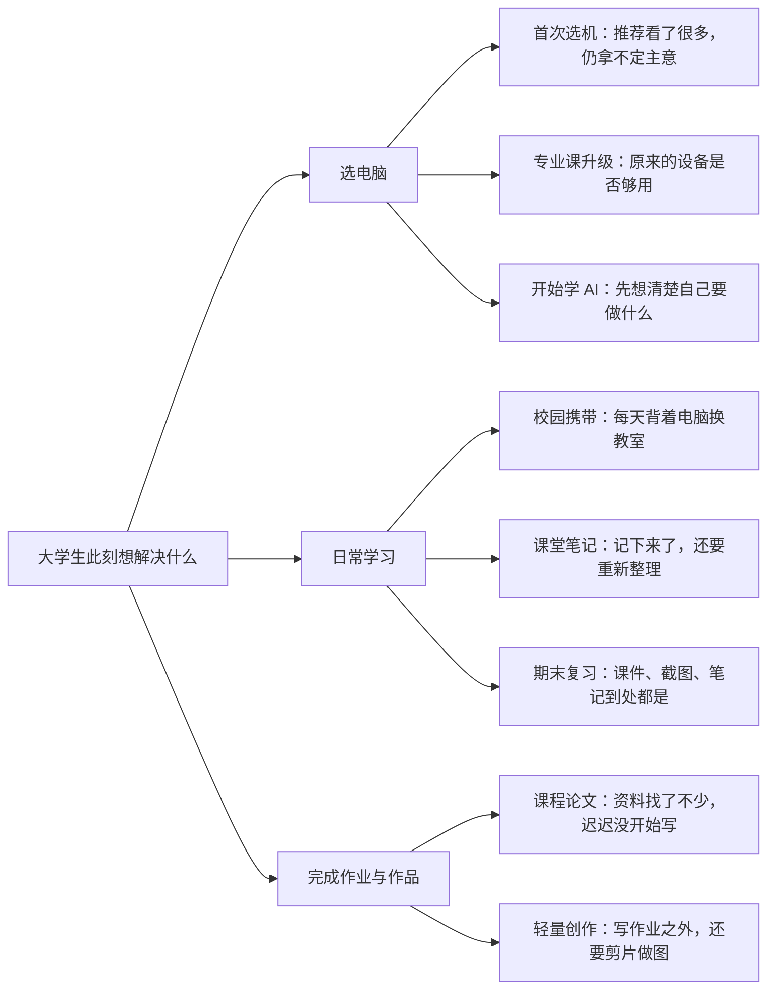

# 校园有解 · 华为 PC 营销 Agent

大学生挑电脑，想的常常不是一串参数。

可能是每天换教室，电脑背起来会不会太累；可能是专业课要用的软件，自己的设备到底够不够；也可能是课上记了一堆笔记，到了期末却不知道从哪里开始复习。

**校园有解**想做的，是听懂这些具体时刻，再把华为 PC 的真实能力讲成学生看得懂、用得上的内容。它面向大学生写小红书等平台文案，让产品信息从“有什么功能”，走到“它和我正在做的事有什么关系”。

## 从学生正在经历的事开始

我们结合小红书平台规则和收集整理的大学生数码热帖，总结选题与表达规律。很多内容都从一个小麻烦开始：推荐看了很多还是不会选，电脑跟着人跑一天，笔记记完还要整理，论文资料找了一堆却迟迟没动笔。

这些观察被整理成八个大学生细分场景。它们描述的是学生当下的任务和困惑，同一个学生也可能在不同时间遇到不同场景。



## 把产品信息说到场景里

文案先从学生正在做的事说起，再顺着他遇到的麻烦，寻找华为产品里真正相关的能力。比如，写课堂记录，就先想清楚学生课后要怎么找到重点；写校园携带，就先让“每天带着电脑换教室”这个处境被看见。

产品能力以对应型号的知识资料为准。资料支持什么，就讲什么；关键使用条件会放在读者看得到的地方。没有资料支撑的功能和效果，不会靠常识补出来。历史优惠不进入文案，学生的亲身体验也不会由 Agent 冒写。

这套面向学生场景、贴近平台表达的写作方法，就是项目里的 Harness。它让接入的模型知道如何选切口、安排信息和组织语气；华为产品资料则负责回答具体设备能做什么。最终希望交付的是有生活感、说得清楚，也有依据的营销内容，而不是把参数表换个说法。

## 我们的核心竞争力

1. **站在用户视角，写真实生活场景。** 从大学生要完成的学习任务、日常使用环境和当下困扰出发，再解释哪些产品能力可能相关。让内容先回答“这和我的生活有什么关系”，避免空洞地罗列功能参数。
2. **加入违禁词与事实审查，让运营少返工。** 在发布前标出风险表达、产品事实依据和需要人工确认的内容，帮助运营更省心地检查与修改。审查是辅助机制，不代表平台审核结论或绝对合规保证。
3. **细分大学生画像，让触达更精准、更高效。** 围绕年级、专业、常用软件、学习任务、校园场景、购买阶段和预算等维度拆解学生需求；信息不足时继续追问，让表达更贴近目标学生真正关心的问题。

## 在工作台里试一篇

选择具体产品和学生场景，就可以生成一篇面向平台的文案与配图思路。工作台也会检查产品事实和常见发布风险，提示需要修改或人工确认的地方。检查结果供运营判断，不等于平台审核结论。

新版工作台会明确区分「只检索到资料」「生成失败」「待复核草稿」和「已检查草稿」。未配置文案模型时会显示缺失项；模型引文或审稿格式错误时各进行一次有限纠正，再执行严格检查。已用本地资料与真实 DeepSeek 调用验证小红书、公众号输出，其中小红书样例仍有配图数量和引用问题需要处理；本轮未验证实时 ima。详见 [改版与实测记录](docs/UI-REDESIGN.md)。

项目在本机运行，不会自动发布内容。首次运行先复制 `.env.example` 为 `.env`，填写自己的模型配置；资料接入方式见 [知识库配置](knowledge-base/README.md)。未配置资料时可查看界面，但不能生成真实产品稿。配置完成后在仓库目录启动：

```bash
python3 server.py
```

然后打开 http://127.0.0.1:8765/ 。在 Windows 上可使用 `python server.py`。这是公开评审代码仓库，不含私有产品知识库、图片包或真实 API Key。完整生成需要接入自己获授权的资料源与模型配置。

**在线界面演示：** [打开校园有解工作台](https://huawei-pc-marketing-studio.z9myjwv29s.chatgpt.site)。这是公开可访问的前端交互样机，目前未连接 ima、本地知识库或模型服务；演示内容不含已核验的产品事实，请勿直接用于发布。真实 Agent 当前仍按上面的本机方式运行。

## 项目资料

- [大学生场景与写作方法](harness/README.md)
- [场景表达参考](harness/voice.md)
- [八个学生场景](harness/scenes.json)
- [写作与核验原则](harness/review.md)
- [发布前检查说明](harness/publish-precheck.md)

## 公开版本与验证

本仓库由团队项目的已验证版本导出，保留核心代码、前端、测试、设计文档与第三方声明；使用独立提交历史，避免携带私有资料。来源与贡献者见 [SOURCE.md](SOURCE.md)。

离线检查不依赖真实模型或私有资料：

```bash
python -m unittest discover -s tests -v
```

浏览器验收套件需要另行配置本地知识库和 Playwright；不将合成测试响应当作真实生成结果。
