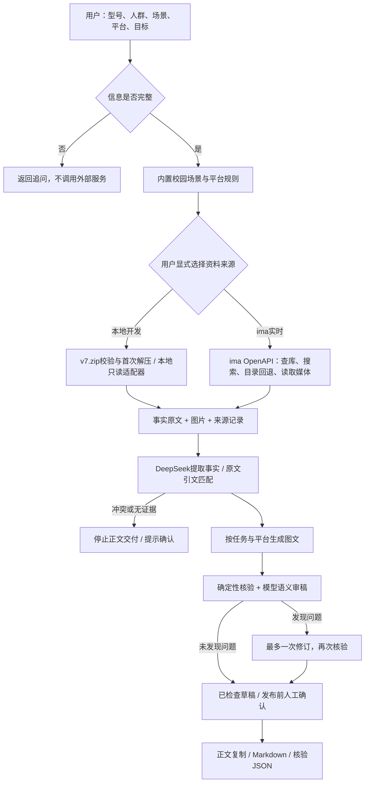
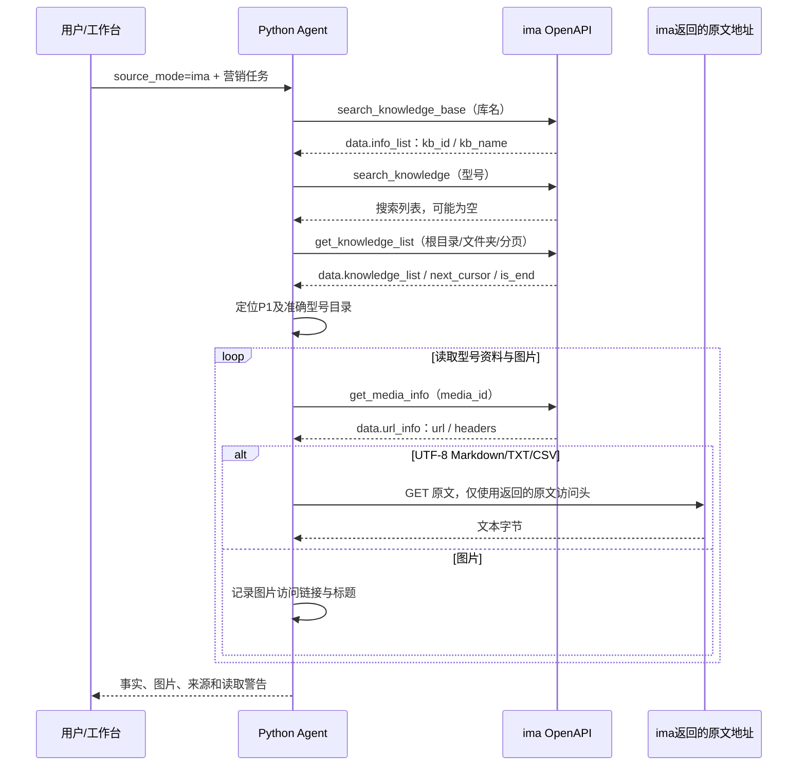

# 设计与实现说明：软文工坊 Agent

本文描述当前代码实际实现。两种资料模式共用生成与核验流程；本地模式不是实时 ima 检索，模型审稿也不是事实正确性保证。

## 1. 总体设计



自研部分是任务校验、业务规则、工具编排、证据引用、错误分流、有限修订、状态与导出。正文由大模型按任务生成，代码没有保存固定软文作为回答，也不把 ima 的写作结果直接转发。

当前场景聚焦大学生的开学、课堂、作业、答辩、社团、专业软件和实习。每个场景定义痛点、切入方向、卖点优先级与追问；平台规则定义结构、语气、配图数量和行动引导。切入方向是规则起点，最终论述、卖点取舍与文案由模型结合证据生成。尚未实现独立的动态规划模型或多Agent协作系统。

## 2. ima 接口实际如何调用

运行代码见 `agent.py` 的 `Ima` 类。官方 ima Skill 已安装在开发者本机用于参考；应用运行时直接用 Python 标准库发 HTTP 请求，不通过 `ima_api.cjs` 子进程。

- Base URL：`https://ima.qq.com/openapi/wiki/v1/`
- 请求：HTTP POST，UTF-8 JSON。
- 认证头：`ima-openapi-clientid`、`ima-openapi-apikey`，来自本机环境变量或忽略的 `.env`。
- 另外发送 `ima-openapi-ctx: skill_version=1.1.10`。
- 后端统一检查 `code == 0`，从 `data` 取数据；非0返回错误，不将失败当作无资料。



请求参数示例只展示结构，不包含真实内部ID：

```json
{"query":"任德耀新建华为PC知识库","cursor":"","limit":20}
```

`search_knowledge_base` 按返回的 `kb_name` 精确匹配库名，内部使用 `kb_id`。目录请求包括 `knowledge_base_id`、可选 `folder_id`、`cursor` 和 `limit=50`。目录实际字段为 `knowledge_list`；不能照搬知识库搜索的 `info_list`。

当前实现会发起型号搜索，并始终浏览P1目录以取得确定的产品原文。搜索结果只记录命中数量，尚未用搜索相关性结果自动拼接证据。目录回退支持P1的01/02/03产品分区，精确匹配型号目录；有分页上限，避免无界遍历。文件夹以媒体类型99识别。

`get_media_info` 可能返回访问地址及额外访问头。文本只支持UTF-8的MD/TXT/CSV，每份最多300KB；当前仅支持受限的ima/腾讯云地址。PDF和笔记类型原文尚未解析。图片访问链接直接交给浏览器展示，仍可能过期或需鉴权，尚未实现远端图片代理。

**已观察到的接口限制**：2026-10-18，原文接口返回“资料获取次数已达上限，请明天再尝试”。这与库不可见、搜索为空不同；程序停止并展示限额错误，不悄悄切换成本地读取。

## 3. 本地 v7 如何运行

用户明确要求为组员提供完整测试资料，因此私有仓库随包包含 `knowledge-base/v7.zip`，以及记录文件数量、大小和SHA256的清单。首次读取时，`dataset.py` 先检查压缩包哈希、展开大小、路径边界和符号链接，再解压；原始资料目录不修改。

`local_kb.py` 精确选择P1重点型号目录，读取事实、限制、图片索引与来源文件，并对图片返回受控的本机URL。`/api/local-image` 只读取知识库范围内的图片，检查扩展名、签名和大小；不能借路径读取 `.env` 或任意文件。

浏览器显式选择：

- `local`：本地开发，返回 `source_kind=local_v7`，不调用ima。
- `ima`：实时接口，返回 `source_kind=ima_live`；失败不自动回退本地。

用户说明本地副本与ima内容相同，但当前未逐项比较远端最新内容。因此输出标注来源和文件时间，不能宣称本地数据刚从ima取回。数据集全板块随包保留，当前自动检索主要使用P1。

## 4. 给 DeepSeek 什么，不给什么

模型使用兼容Chat Completions接口。官方DeepSeek设置结构化JSON输出并关闭思考模式，限制输出长度；其它兼容服务只使用通用参数。

发给模型：任务字段、场景和平台策略、检索文本、事实编号、图片名称/来源等元数据。图片访问URL在模型输入前移除；ima认证头、DeepSeek Key、知识库内部ID不进入提示词。模型不会接收图片像素，所以当前不是视觉核验。

调用顺序：事实提取 → 生成 → 语义审稿；若发现问题，再修订 → 复审。最多5次模型调用。模型可能仍输出不可靠结果，未解决问题保留为 `needs_review`，不假装已通过。

## 5. 核验究竟证明什么

**产品事实**：每条 `claim` 必须对应 `source_id` 和原文 `quote`。确定性检查忽略排版空白，保留其它字符，拒绝参数改写或不存在的引文。引文匹配只证明引文存在，不能单独证明整句推断成立；语义关系和条件遗漏由模型辅助审查，最终仍需人工确认。

**图片型号**：读取当前资料中的 `图片索引.csv`，按文件名匹配“产品型号”“来源页面”等字段，检查目标型号与年份。缺索引、缺年份、型号错配或无法确认具体配置均标记待复核。`catalog_match`仅表示索引一致，不证明画面、SKU或授权无误。当前未识别图片像素。

**营销合规**：代码检查风险表达、价格金额、折扣、补贴等，模型另检查虚构承诺与无依据比较。价格/权益有效期尚未结构化验证，所以出现动态金额会保守标记人工复核；规则不能覆盖所有法律判断。

## 6. 临时改写与追溯

服务内存最多保留20次带正文结果，原证据快照30分钟有效。`/api/rewrite`从服务端取得旧证据，不接受浏览器自行提交“已验证资料”；换型号、版本、来源模式、证据超时或重启服务，要求重新检索。改写重新提取事实、生成并核验，不直接拼接旧稿。

每次运行记录：运行编号、UTC开始时间、来源模式、阶段状态、原文SHA256、逐条事实引文、图片索引检查、合规标记和待确认项。改写额外保留父运行编号与原证据时间。核验JSON不含图片签名URL，但可能含资料引文，按团队资料范围保管。

## 7. 如何证明真的运行

组员克隆或下载ZIP后，运行 `python server.py`，默认本地开发模式。未配置模型也能测试读取和图片；填入自己的 `LLM_API_KEY` 后生成真实文案。详见根目录README。

已有真实ima读取、DeepSeek生成及本地v7生成记录。部分结果仍被标为待复核；本地记录不能替代初赛所需的ima运行证据。建议连续录制输入、策略、检索来源、正文、配图、核验、改写和导出；另补跨场景/平台的结果。

当前仓库是团队私有测试包，包含资料；若要向评委开放或转为公开，应另制作不含数据集和凭证的代码发布包。
